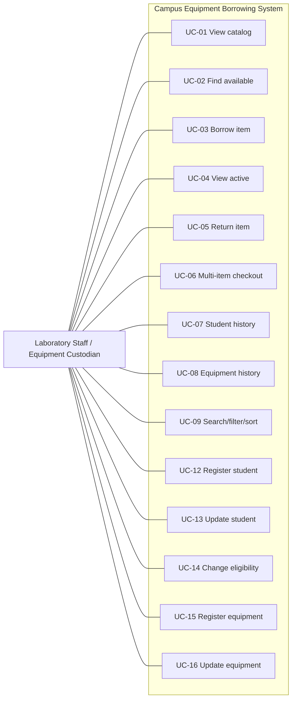

# Activity 4 Use Case Catalog

Primary actor for the required workflows: **Laboratory Staff / Equipment Custodian**. The complete actor interactions, branches, business-rule references and acceptance criteria are preserved in the supplied suite at `activity4-use-case-suite.docx`.

| ID | Use case | Classification |
|---|---|---|
| UC-01 | View Equipment Catalog | Required continuation |
| UC-02 | Find Available Equipment | Required continuation |
| UC-03 | Borrow Equipment | Required continuation |
| UC-04 | View Active Borrowings | Required continuation |
| UC-05 | Return Equipment | Required continuation |
| UC-06 | Check Out Multiple Equipment Items | Required new |
| UC-07 | View Student Borrowing History | Required new |
| UC-08 | View Equipment Borrowing History | Required new |
| UC-09 | Search, Filter, and Sort Borrowings | Required new |
| UC-10–11 | Overdue Borrowings; Current Equipment Holder | Deferred to Activity 5 |
| UC-12 | Register Student | Required new |
| UC-13 | Update Student Information | Required new |
| UC-14 | Change Student Borrowing Eligibility | Required new |
| UC-15 | Register Equipment | Required new |
| UC-16 | Update Equipment Information | Required new |
| UC-17–27 | Equipment retirement, maintenance, condition, renewals, bulk returns, summaries, categories and voiding | Deferred to Activity 5 |
| UC-28–33 | Reservations, staff accounts, audit and exports/integrations | Future scope |

## Use Case Diagram

